# PMS

面向**单个企业**的自部署项目管理系统。工作台、项目交付、组织与权限都在一个实例里完成。不是多租户 SaaS，也不拆微服务。

本仓库是安装入口，使用预构建镜像。本机不需要安装 Java、Maven、Node.js 或 pnpm。源码在 [`pms-backend`](https://github.com/xiebinJava/pms-backend) 和 [`pms-front`](https://github.com/xiebinJava/pms-front)。

[](https://github.com/xiebinJava/pms-distribution/releases)
[](https://github.com/xiebinJava/pms-distribution/actions/workflows/validate.yml)
[](LICENSE)

<p align="center">
  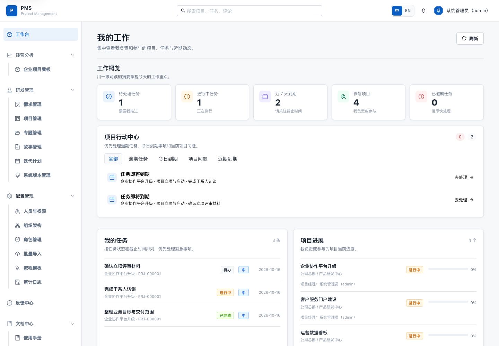
</p>

<p align="center">
  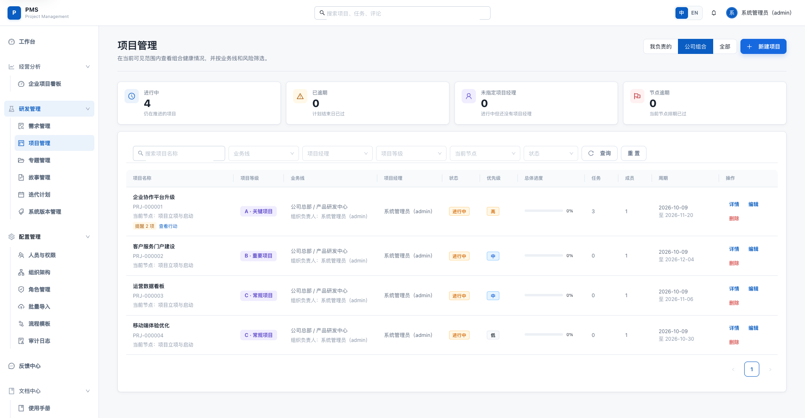
  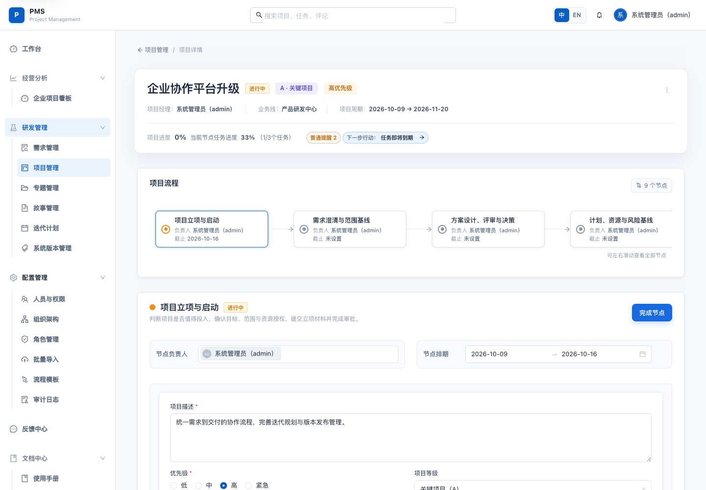
</p>

<p align="center">
  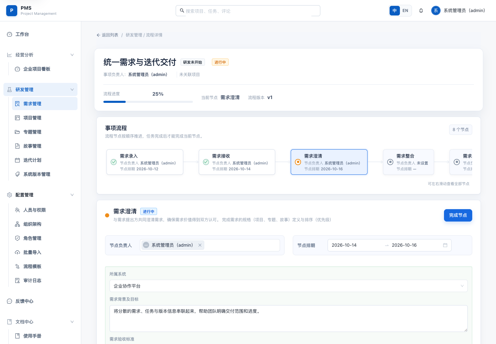
</p>

<p align="center">
  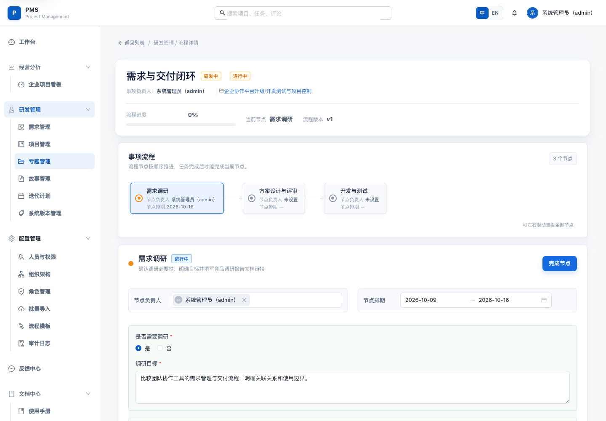
  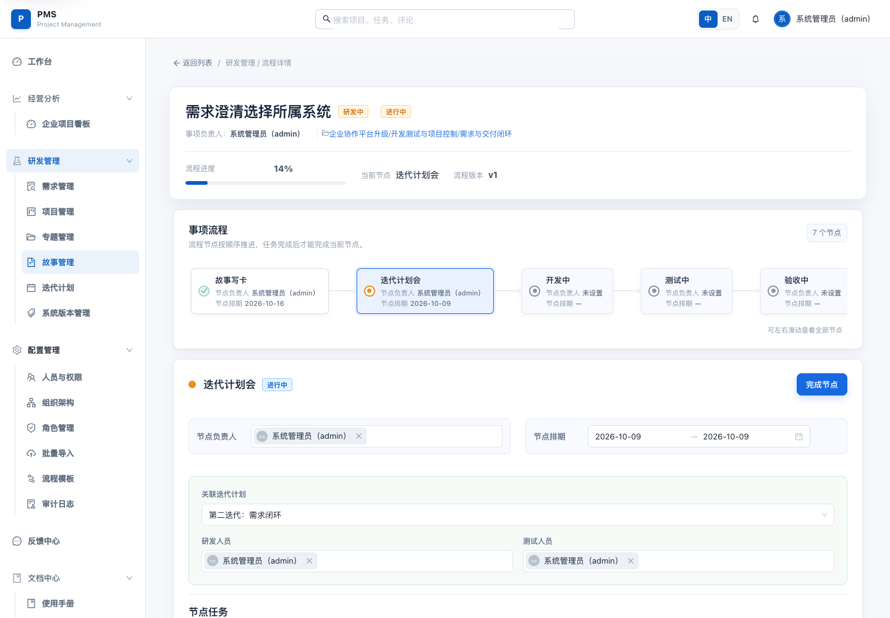
</p>

<p align="center">
  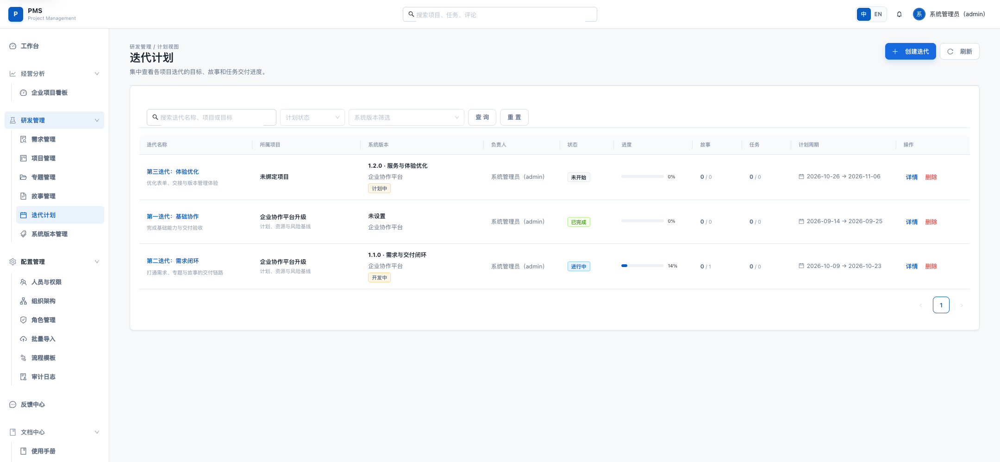
</p>

<p align="center">
  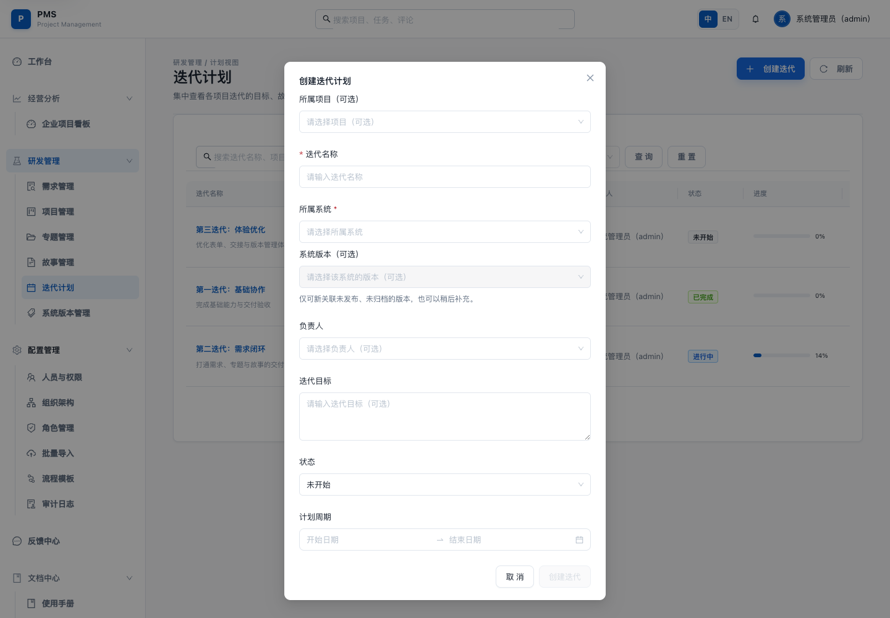
  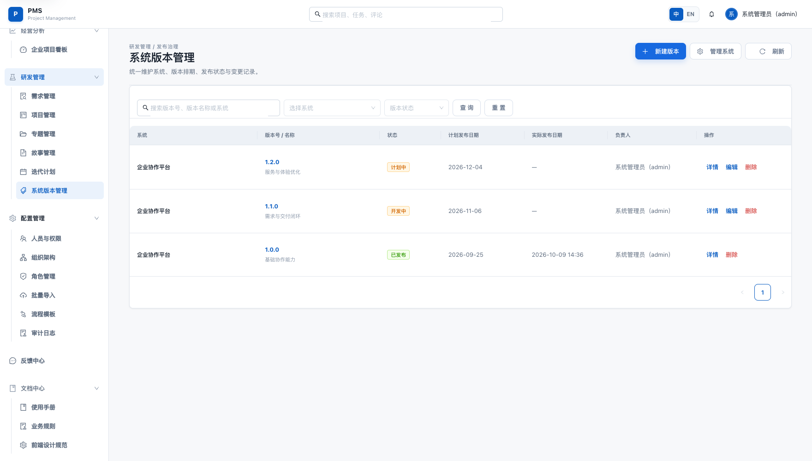
</p>

<p align="center">
  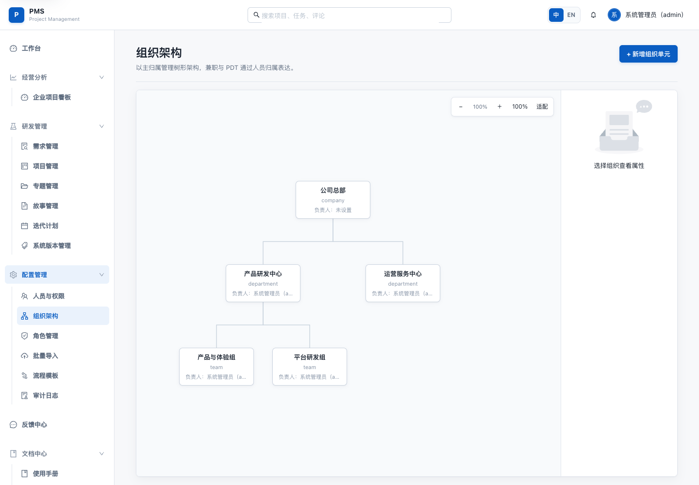
  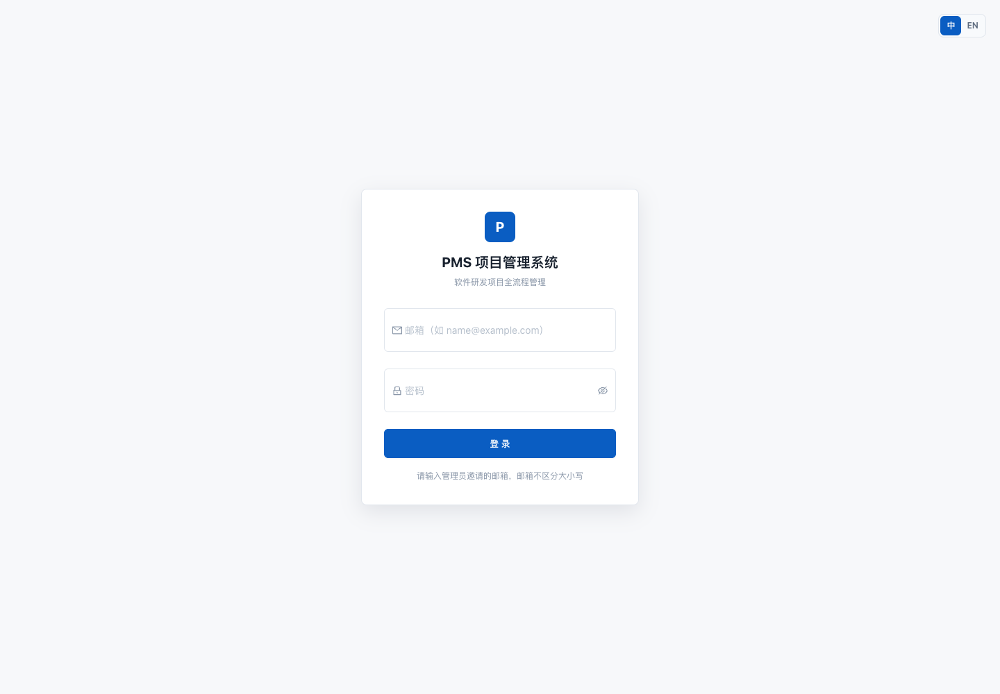
</p>

<p align="center">
  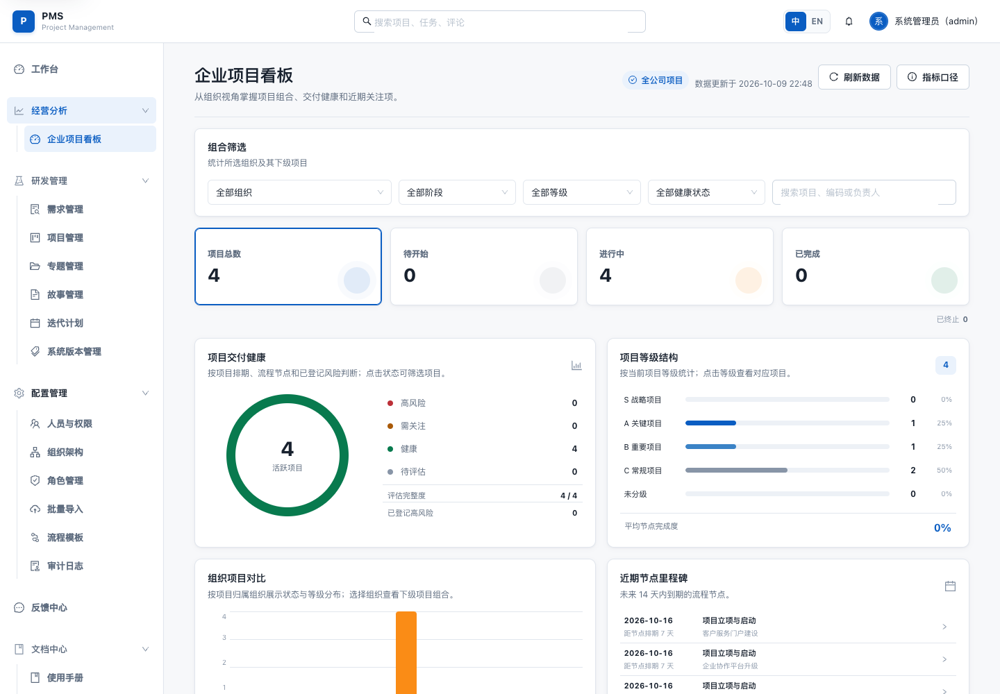
</p>

<p align="center">
  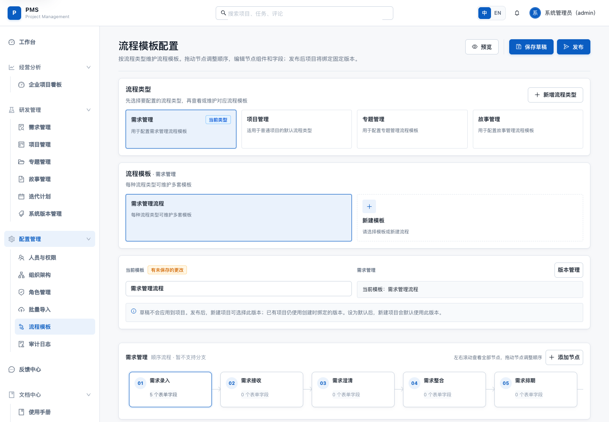
  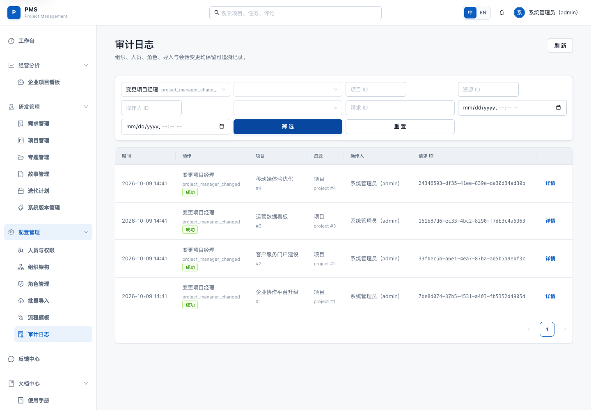
</p>

<p align="center"><sub>以上 14 张截图于 2026-10-09 使用正式 1.1.0 镜像重新拍摄，均为中文界面。项目、需求、专题、故事、迭代、系统版本和组织信息来自隔离演示库中的虚构数据，不包含真实业务或人员信息。点击图片可查看原图。</sub></p>

## 1.1.1 更新重点

- **AI 参与项目管理生命周期**：后端提供可授权的资源上下文、能力查询、项目创建回读和需求分析成果保存契约，配套 `pms-cli` 可通过自然语言入口安全调用。
- **系统版本关联视图**：系统版本详情新增关联项目、专题、故事和来源迭代的展示，按项目和迭代组织信息，不把专题与迭代误表示为上下级关系。
- **发行一致性**：前后端镜像、发行仓库和安装包统一锁定到 `1.1.1`，继续使用固定版本镜像，不使用 `latest`。

## 1.1.0 更新重点

- **需求到交付闭环**：需求、项目、专题、故事分别使用自己的流程模板，需求可关联项目、专题或故事。功能需求在需求澄清节点选择所属系统，非功能需求不展示该字段。
- **迭代与系统版本**：迭代可以独立创建，也可以关联项目；负责人全员可选。创建迭代时可选择所属系统和对应版本，有需求来源的关联对象自动继承系统。系统版本只在迭代中关联，版本状态统一为计划中、开发中、已发布、已归档，新版本默认为计划中。
- **流程模板与节点体验**：支持四类管理流程的节点、字段和业务工作台配置。新安装使用统一名称的系统模板，初始版本不展示版本标签；用户发布后续版本时显示版本号。普通字段自动保存不弹成功提示，节点完成不再弹二次确认，需求、专题、故事的布局与填写完成底色统一。
- **运营交接**：项目交接只填写交接人和交接说明，完成节点时两项必填，系统与版本由关联迭代汇总。
- **企业项目看板**：从组织视角查看项目组合、阶段、等级、交付健康、风险、节点里程碑与近期关注项目，并支持按组织、阶段、等级和健康状态筛选。
- **审计与治理**：审计列表和详情保留动作、资源、操作人、请求 ID 及变更前后差异；系统自动生成的无项目/无操作人记录也可以稳定展示。
- **文档与演示**：README、变更记录和演示截图同步更新，方便直接了解核心工作流和企业级项目组合视图。

## 需求、项目、专题、故事与迭代

需求通过接收、澄清、整合、排期、开发、验收和上线节点推进。排期和开发可以关联项目、专题或故事。功能需求在澄清时确定所属系统，迭代依据需求关联链路继承系统；没有来源系统时，在创建迭代的窗口选择系统。

研发交付采用“项目 → 项目流程节点 → 开发与迭代控制 → 专题 → 故事”的关系。项目流程模板可以把任意节点配置为专题绑定节点；项目实例使用该模板后，专题会出现在这个节点的开发与迭代控制工作区中。绑定节点不是写死的，后续可以在流程模板中调整。

- 需求、项目、专题、故事分别使用各自类型的已发布流程模板；详情页会沿用统一的流程节点、字段、负责人、排期和节点任务组件。
- 专题通常在项目的开发与迭代控制工作区中拆分，故事在专题流程的具体节点下拆分；专题和故事也都可以暂不关联上级对象。
- 专题可以关联任意进行中的项目，也可以保持未关联；已完成、已终止或已删除的项目不能新增关联。未关联项目的专题对所有人可见。
- 故事可以关联专题，也可以保持独立。关联或改绑时，负责人、节点负责人和任务执行人会按关联关系同步到上级对象的成员范围。
- 节点负责人、节点排期、节点字段和节点任务均在详情页直接编辑；任务和子任务只归属于当前流程节点，节点完成后才能推进流程。
- 专题组织业务交付范围，迭代组织一个时间段内的故事与任务交付；迭代不配置流程模板，可以不关联项目，并支持手动选择未开始、进行中、已完成、已暂停。
- 系统版本由迭代关联，需求、项目、专题和故事不单独维护发布版本。迭代和系统版本列表均支持删除，关联处理遵循服务端校验。

## 能做什么

| 模块 | 说明 |
| --- | --- |
| 工作台 | 汇总当前账号的任务、参与项目和最近评论，不是全公司总览 |
| 项目交付 | 固定节点流转（立项、需求范围、方案评审、计划与风险等），任务挂在节点上 |
| 流程模板 | 按流程类型维护可发布版本，配置需求、项目、专题、故事的节点字段、业务组件和默认模板 |
| 需求管理 | 接收、澄清、整合、排期、开发、验收和上线，功能需求绑定所属系统 |
| 研发管理 | 管理专题、故事，按各自流程模板推进节点、负责人、排期与任务 |
| 迭代计划 | 独立或项目内迭代，关联故事和任务，维护系统、版本、负责人、排期与状态 |
| 系统版本 | 维护系统与版本、发布日期、状态和变更记录 |
| 企业项目看板 | 组织级项目组合、交付健康、风险与里程碑视图 |
| 组织与人员 | 主职组织树、角色权限、邀请开通、批量导入 |
| 协作与治理 | 评论、通知、反馈、审计日志 |
| 可选登录 | 默认使用本地密码，也可接入 LDAP / OIDC |

一个部署实例只服务一家企业，没有 `tenant_id`。

## 三步启动

需要 Docker Engine 或 Docker Desktop，以及 Compose v2。默认数据库是 **MySQL 8.4**，Docker 建议至少分配 **2 GiB** 内存。

```bash
git clone https://github.com/xiebinJava/pms-distribution.git
cd pms-distribution
./scripts/bootstrap.sh
```

打开 <http://localhost:5173>。首次空库会创建初始管理员：

| 项 | 值 |
| --- | --- |
| 登录邮箱 | `admin@example.com` |
| 密码 | `PmsAdmin123!` |

请立刻修改该密码。MySQL 与 JWT 等基础设施密钥仍由脚本随机生成，写入未被 Git 跟踪的 `.pms-bootstrap-secrets`。生产部署必须更换管理员密码（`validate-production-config.sh` 会拒绝上述默认值）。

当前发行版本：[`1.1.1`](https://github.com/xiebinJava/pms-distribution/releases/tag/v1.1.1)。镜像在 GHCR，可匿名拉取，支持 `linux/amd64` 和 `linux/arm64`。

也可直接下载 [tar.gz 安装包](https://github.com/xiebinJava/pms-distribution/releases/download/v1.1.1/pms-1.1.1.tar.gz)、[zip 安装包](https://github.com/xiebinJava/pms-distribution/releases/download/v1.1.1/pms-1.1.1.zip) 和 [SHA256SUMS](https://github.com/xiebinJava/pms-distribution/releases/download/v1.1.1/SHA256SUMS)。把两个安装包与校验文件放在同一目录，运行 `sha256sum -c SHA256SUMS`（macOS 使用 `shasum -a 256 -c SHA256SUMS`）核对后再解压安装。

安装、升级、备份恢复与正式镜像界面的验收范围见 [1.1.0 发布验收记录](docs/operations/release-1.1.0-verification.md)。1.1.1 复用同一发行流程，并新增 AI 连接器和系统版本关联能力；本版对两项 Spring MVC 发现采用限定到包版本、JAR 路径且于 2026-11-09 到期的“不具备触发条件”例外；这不代表依赖已修复，详见 [安全适用性评估](https://github.com/xiebinJava/pms-backend/blob/main/docs/security/1.1.0-spring-mvc-assessment.md)。其他 HIGH / CRITICAL 安全门禁保持启用。

## 使用 pms-cli 让 AI 操作 PMS

PMS 的 Web 界面负责人工查看和确认，`pms-cli` 负责把 PMS 的权限、流程模板、字段校验、幂等和审计能力提供给 GPT、Claude、Codex、DeepSeek 等本地 AI 工作台。用户在 AI 聊天窗口中用自然语言提出请求，AI 再调用本机的 `pms` 命令完成读取、预览、写入和结果回读。

`pms-cli` 不是另一个 PMS 服务，也不是一个独立的聊天窗口；它是 AI 工作台与当前 PMS 实例之间的安全连接器。项目地址：[xiebinJava/pms-cli](https://github.com/xiebinJava/pms-cli)，npm 包：[`@brad.xie/pms-cli`](https://www.npmjs.com/package/@brad.xie/pms-cli)。

### 安装和首次配置

本机需要 Node.js 22 或更高版本。PMS 已经启动后，在终端执行：

```bash
npm install -g @brad.xie/pms-cli
export PMS_BASE_URL=http://localhost:5173/api
pms doctor --format json
pms auth login
pms auth status
```

`PMS_BASE_URL` 必须是纯 URL，不要粘贴 Markdown 链接。`pms auth login` 会打开 PMS 登录页，登录后的长期凭据保存在操作系统钥匙串中，不会把 Token 打印到终端。

如果使用 Codex，可以继续安装 PMS 工作台 Skill：

```bash
pms skill install --global
pms doctor --format json
```

Skill 的作用是告诉 AI 什么时候读取 PMS 上下文、什么时候必须先预览、哪些操作需要用户明确确认；真正的权限和业务校验仍由 PMS 后端执行。其他本地 AI 工作台可以参考 [pms-cli 安装说明](https://github.com/xiebinJava/pms-cli/blob/release/docs/installation.md) 安装同一份 Skill。

Windows PowerShell 设置地址时使用：

```powershell
$env:PMS_BASE_URL = "http://localhost:5173/api"
```

### 在 AI 聊天窗口中使用

安装并登录后，在已经配置本地 CLI 的 GPT、Claude、Codex 或 DeepSeek 工作台中直接用自然语言描述目标。例如：

```text
读取当前 PMS 中的项目列表，告诉我每个项目的名称、负责人、状态和时间范围。
```

```text
先读取当前可用的项目类型和流程模板。如果有必填信息先问我；然后创建项目“AI Native PMS”，描述是“让 AI 参与项目管理全生命周期”，优先级中，开始日期 2026-10-12，结束日期 2026-11-30。创建后回读项目详情和流程上下文。
```

```text
读取需求 23 的当前流程节点、可写能力和上下文版本，分析“搭建一个智能体”的目标、用户场景和验收标准。保存前先展示准备写入的内容，得到我确认后再保存，并回读需求详情和审计引用。
```

AI 应该先读取事实和当前流程上下文，再执行写入。项目创建和需求分析保存都必须返回执行结果、精确回读数据以及 `trace.operationId`，便于在 PMS 审计日志中追踪。

### 手动验证 pms-cli

如果暂时没有可用的 AI 聊天工作台，也可以直接在终端验证连接器：

```bash
pms capabilities --format json
pms search project --keyword AI --format json
pms get project 7 --format json
pms context project 7 --format json
pms dashboard summary --format json
```

写操作分为“只读计划”和“明确执行”两步：

```bash
# 只读：读取项目类型和流程模板，生成创建预览
pms scenario project-create plan \
  --arguments-json '{"name":"AI Native PMS","description":"让 AI 参与项目管理全生命周期"}' \
  --format json

# 写入：必须由调用方明确执行，并提供幂等键
pms scenario project-create execute \
  --arguments-json '{"name":"AI Native PMS","description":"让 AI 参与项目管理全生命周期"}' \
  --idempotency-key project-ai-native-pms-1 \
  --format json
```

需求分析保存需要明确需求 ID、节点 ID、上下文版本和写入字段；CLI 不会猜测节点、自动完成节点、修改所属系统或覆盖人工正文：

```bash
pms scenario requirement-analysis plan 23 \
  --node-id 301 --version 7 \
  --arguments-json '{"interpretation":"补充用户场景和验收标准"}' \
  --format json

pms scenario requirement-analysis execute 23 \
  --node-id 301 --version 7 \
  --arguments-json '{"interpretation":"补充用户场景和验收标准"}' \
  --idempotency-key requirement-analysis-23-7 \
  --format json
```

其中 `plan` 不写入数据，`execute` 才会写入。重复请求必须复用同一个幂等键；如果是正式环境，建议先让 AI 展示计划和待写入字段，再由用户明确确认。

### 常见问题

- `pms: command not found`：重新打开终端，确认 npm 全局 bin 目录已加入 PATH，或执行 `npm prefix -g` 检查全局安装位置。
- `auth status` 反复弹钥匙串：在系统钥匙串弹窗中允许当前终端或 `node` 访问“pms-cli”，必要时重新执行 `pms auth login`。
- `doctor` 显示地址错误：检查 `PMS_BASE_URL` 是否为 `http://localhost:5173/api` 或实际部署地址，不能带 Markdown 方括号和圆括号。
- AI 只能给出草稿：先运行 `pms capabilities --format json` 和对应资源的 `pms context`，确认当前账号拥有目标流程节点的写权限。

如果改了 `PMS_PORT`，请把 `PMS_CORS_ALLOWED_ORIGINS` 和 `PMS_PUBLIC_BASE_URL` 改成同一端口。只改端口、不改 CORS 时，浏览器登录会被后端拒绝。`bootstrap.sh` 在端口已改、CORS 仍是示例值时，会自动对齐（见下方配置）。

## 常用命令

```bash
./scripts/status.sh
./scripts/logs.sh backend
./scripts/backup.sh
./scripts/upgrade.sh 1.1.1
```

升级前先更新本仓库的安装脚本，再执行升级命令。1.1.0 修复了旧脚本导出旧版本环境变量、导致 Compose 仍拉取旧镜像的问题；不能仅修改旧安装目录中的 `.env` 就认为升级已完成。升级会先备份，数据库迁移至 V69，其中项目交接的已废弃历史字段会被清理。

脚本默认用仓库目录名作为 Compose 项目名（本仓库为 `pms-distribution`）。隔离环境请让每条命令使用同一组变量：

```bash
COMPOSE_PROJECT_NAME=pms-staging ENV_FILE=.env.staging COMPOSE_FILE=compose.yaml ./scripts/bootstrap.sh
COMPOSE_PROJECT_NAME=pms-staging ENV_FILE=.env.staging COMPOSE_FILE=compose.yaml ./scripts/status.sh
```

停止服务但保留数据：

```bash
docker compose --env-file .env -f compose.yaml down
```

不要使用 `down -v`，除非你明确要删除数据库和附件。

## 支持范围

| 项目 | 当前发行路径 |
| --- | --- |
| 容器运行时 | Docker Engine / Docker Desktop / Colima + Compose v2 |
| 数据库 | 仅 MySQL 8.4 |
| 前端入口 | Nginx 容器，默认 `5173` |
| 后端入口 | 仅容器网络可见，默认 `8080` |
| 生产 HTTPS | 由企业反向代理或 Ingress 负责 |

完整组合见 [支持矩阵](docs/operations/support-matrix.md)。

## 配置

首次启动前可以编辑 `.env`。敏感值只放在本地 `.env`、Docker secrets 或外部密钥管理器，不要提交到 Git。

改入口端口时，至少同步这三项：

```bash
PMS_PORT=5173
PMS_PUBLIC_BASE_URL=http://localhost:5173
PMS_CORS_ALLOWED_ORIGINS=http://localhost:5173,http://127.0.0.1:5173
```

`bootstrap.sh` 会在 `PMS_PORT` 不是 `5173`、且 CORS / 公网地址仍是示例值时，自动改成当前端口。

生产环境至少需要：

- `PMS_DEPLOYMENT_ENV=production`
- 由密钥管理器注入的 `PMS_JWT_SECRET`
- 非默认的数据库和管理员密码
- 正式域名、HTTPS 和受限的 `PMS_CORS_ALLOWED_ORIGINS`
- SMTP、对象存储、备份策略和监控告警

完整说明见 [生产配置](docs/operations/production.md)。

## 内存与本地开发的差别

使用 Docker Desktop 时，建议至少分配 **2 GiB** 内存。首次拉镜像和初始化 MySQL 可能要一两分钟。

启动脚本会在拉镜像前检查 Docker 内存。低于 `PMS_MIN_DOCKER_MEMORY_GIB`（默认 2 GiB）会直接提示并退出。已确认资源足够时，可在 `.env` 里调整该阈值。

本地开发能跑起来，不代表一台内存很小的机器一定能完成发行包冷启动：

- 本地开发可能已经有初始化过的数据卷
- 本地前后端可能跑在宿主机上，不和 MySQL 抢同一块虚拟机内存
- 发行包是全新冷启动，要同时拉起数据库、后端 Flyway 和前端
- Docker 内存还要分给引擎和其他容器

Colima 用户请给对应 profile 同样的内存，并把 Compose 工程放在 `$HOME` 下，以便虚拟机挂载。

## 仓库关系

```text
pms-distribution   安装、升级、备份、发行文档（你在这里）
pms-backend        Spring Boot API、迁移、后端镜像
pms-front          Vue / Nginx 前端和前端镜像
```

发行仓库只引用经过测试的镜像版本，避免复制源码造成版本漂移。

## 开发与发布

```bash
bash scripts/test-distribution-contract.sh
bash scripts/test-compose-config.sh
bash scripts/test-operations-safety.sh
./scripts/check-privacy.sh
bash -n scripts/*.sh docker/*.sh
git diff --check
```

发布顺序：源码仓库测试并发布镜像 → 更新本仓库 `PMS_VERSION` → 干净环境启动 / 升级 / 恢复 → 创建 Release。

## 文档

| 文档 | 说明 |
| --- | --- |
| [生产配置](docs/operations/production.md) | 上线前必须完成的安全与运行配置 |
| [升级](docs/operations/upgrade.md) | 备份、升级和失败回滚 |
| [备份与恢复](docs/operations/backup-restore.md) | 数据库与附件归档 |
| [故障排查](docs/operations/troubleshooting.md) | 常见启动、登录和迁移问题 |
| [支持矩阵](docs/operations/support-matrix.md) | 当前支持与不支持的组合 |
| [发布镜像](docs/operations/release-images.md) | GHCR 发布顺序与校验 |
| [干净环境冒烟验收](docs/operations/clean-machine-smoke-test.md) | 发布前必过清单 |
| [发行镜像归因](docs/operations/image-attribution.md) | 第三方镜像来源 |
| [变更记录](CHANGELOG.md) | 版本变更 |
| [贡献指南](CONTRIBUTING.md) | 如何提交改动 |
| [安全策略](SECURITY.md) | 漏洞私下报告 |

问题跟踪用 Issues，使用讨论用 [Discussions](https://github.com/xiebinJava/pms-distribution/discussions)。

## 许可证

Apache-2.0，详见 [LICENSE](LICENSE) 和 [NOTICE](NOTICE)。第三方镜像和依赖仍受其各自许可证约束。
